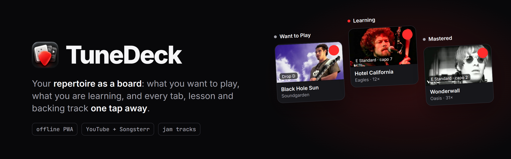
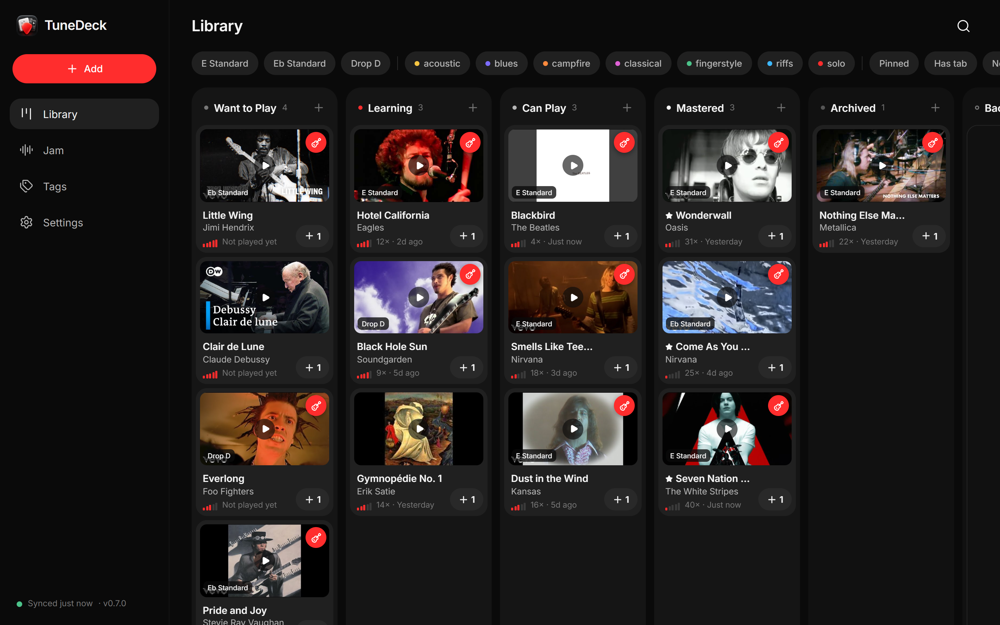
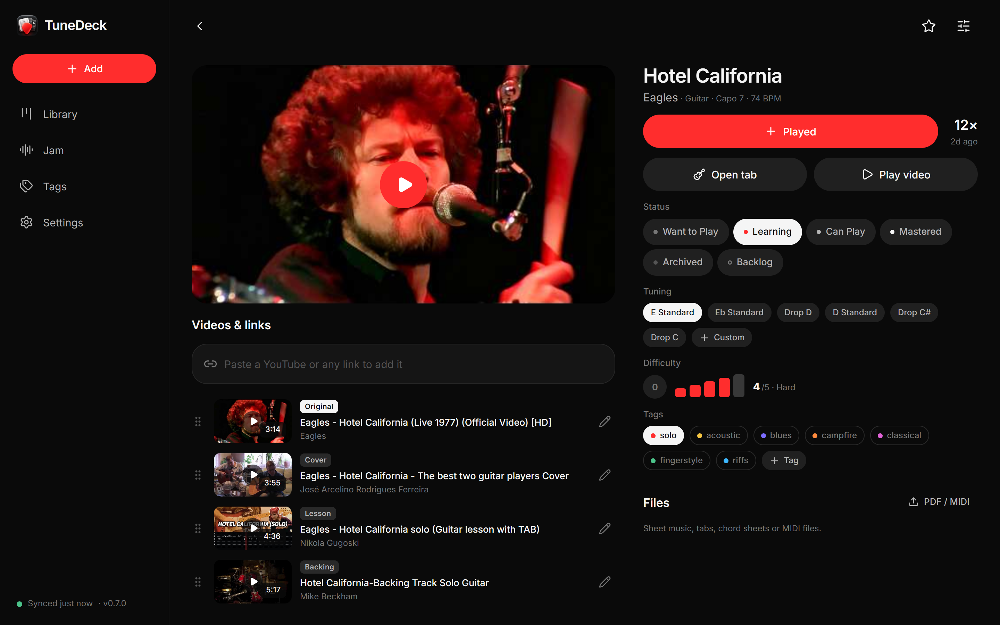
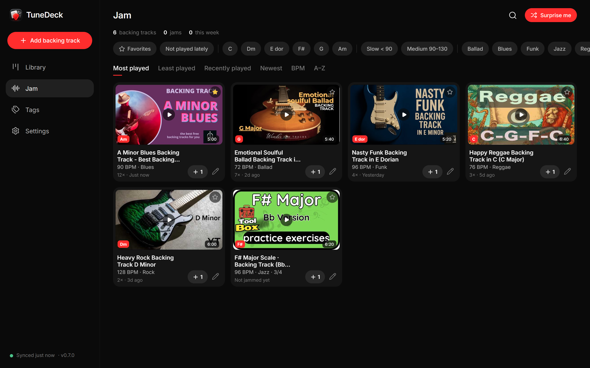
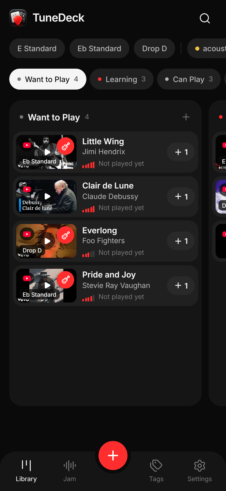

<div align="center">

<picture>
  <source media="(prefers-color-scheme: dark)" srcset=".github/assets/banner-dark.png">
  <source media="(prefers-color-scheme: light)" srcset=".github/assets/banner-light.png">
  
</picture>

<br>


<br><br>

**A private, offline-friendly PWA for your musical repertoire.**<br>
What you want to play, what you're learning, what you can play, the tuning, the Songsterr tab,<br>
and every YouTube original, cover, lesson and backing track, one tap away.

[Screenshots](#screenshots) · [How it works](#how-it-works) · [Local development](#local-development)

</div>

## Screenshots



<table>
  <tr>
    <td width="50%"></td>
    <td width="50%"></td>
  </tr>
  <tr>
    <td align="center"><b>Song</b> · tuning, capo, difficulty, tags, videos and files</td>
    <td align="center"><b>Jam</b> · backing tracks by key, tempo and style</td>
  </tr>
</table>

<details>
<summary><b>On a phone</b></summary>
<br>
<p align="center"></p>
</details>

<sub>A sample repertoire with real YouTube videos; play counts and progress are made up. See the full product spec in <a href="tunedeck-product-spec.md"><code>tunedeck-product-spec.md</code></a>.</sub>

## Stack

- **Next.js 16** (App Router, Turbopack) + React 19 + TypeScript
- **Neon Postgres** via Drizzle ORM (`@neondatabase/serverless` HTTP driver)
- **Neon Object Storage** (S3-compatible) for PDF/MIDI — browser uploads with presigned URLs
- **PWA**: web manifest with Android **Share Target**, hand-written service worker (`public/sw.js`)
- **Offline**: IndexedDB cache + mutation outbox (`src/lib/client/store.ts`)

## How it works

- **Board.** The Library is a kanban (`src/app/(app)/page.tsx`): Want to Play → Learning → Can Play →
  Mastered → Archived. Drag cards between columns or reorder inside one (manual `position` per entry).
  On phones: one column per screen, swipe between them, long-press to drag, or drop on the sticky
  status pills to move a card to any column.
- **Embedded YouTube.** YouTube resources play inside the app (IFrame Player API, `src/components/Player.tsx`)
  and minimize into a mini-player that keeps playing while you navigate. Songsterr links are a direct
  redirect so the OS can hand them to the Songsterr app.

- **Local-first data.** The client keeps a full snapshot in IndexedDB and renders from it instantly.
  Every change is an idempotent *op* (`src/lib/shared/types.ts`) applied optimistically by a shared
  reducer (`src/lib/shared/reduce.ts`) and queued. `POST /api/ops` replays the queue in one Neon batch;
  `GET /api/snapshot` pulls fresh state and pending ops are rebased on top. Works fully offline.
- **Auth.** One access code → server checks `sha256(UPPERCASE(code))` against `ACCESS_CODE_HASH` →
  creates a device session row and sets a signed, HttpOnly, 400‑day cookie. The raw code is never stored.
  Settings lists devices and can sign out the others.
- **AI agent link.** Settings → *AI agent link* creates a secret, read-only URL
  (`/api/feed/<token>`, add `?format=md` for Markdown) with every song, its status, tuning, capo,
  difficulty, tags and play count, to hand to an AI agent ("which pedal fits what I play?").
  No videos, files or settings. Replace or turn it off at any time; the token is never synced or exported.
- **YouTube enrichment** never blocks saving: the video ID and thumbnail are derived instantly, then
  `/api/enrich` fetches title/channel/duration (YouTube Data API if `YOUTUBE_API_KEY` is set, otherwise
  oEmbed + watch page), cached in the `media_cache` table. Failed/offline enrichments retry later.
- **Songsterr** is just a canonical HTTPS link (opens the app when installed). Pasting one best-effort
  reads the page title to prefill song/artist.

- **Riffs.** Learn just a part of a song (intro, main riff, solo) with its own status and color.
  Built for hands on the guitar: in the player one big button marks a riff (tap at its start, tap
  at its end, it loops; taps are shifted back 0.25s for reaction time), and **M** on a keyboard or pedal
  does the same. A colored timeline under the video shows every riff in it; tap one to loop it, with a
  loop counter and ±0.5s nudges. Each video keeps its own mark: switching versions keeps the riff
  selected, a video of the same length (e.g. standard tuning) gets the timing copied, and any other
  video needs one tap at the start, the end coming from the riff's length elsewhere. Video lists show
  colored strips of where each riff sits. The `/riffs` tab groups them by status; *Warm up* plays a
  random one you already know. A song can be **Just riffs** (chosen when adding it, or
  switched on the song page): it stays off the Library board and lives only in the Riffs tab.

- **Jam.** A separate library of YouTube backing tracks (`/jam`) with key, tempo, style and meter
  (read from the video title when possible, plus tap tempo). Filter by key/tempo/style, sort by plays,
  "Surprise me" picks a random one (favouring the least played), and the player suggests scales for the key.
  Jams are counted like songs: manually or automatically from the embedded player.

## Videos on phones and tablets (desktop app)

`desktop/` is a small Windows app (Electron) that lives in the tray. It downloads the library's
YouTube videos with `yt-dlp`, renders a standard-tuning copy for songs in other tunings with
`ffmpeg`'s Rubber Band filter, and sends the files to phones/tablets over the local Wi-Fi.
Nothing is stored in the cloud: files live in `Videos\TuneDeck` on the PC and in Cache Storage
on each device.

- Discovery: the app polls `/api/desktop` (Vercel Runtime Cache, not Postgres). A phone that sees
  it online posts a WebRTC offer there and gets the answer back; the data channel then connects
  directly. No STUN/TURN is used, so it only connects on the same network.
- On phones/tablets, a video stored on the device opens in TuneDeck's own player (gestures,
  A–B loop, tuning switch). Desktop browsers always use the YouTube embed.
- Needs `yt-dlp` and an ffmpeg "full" build on the PATH (`winget install Gyan.FFmpeg`).
- Build and create the Desktop/Start Menu shortcuts: `cd desktop && npm install && npm run build`.

## Local development

```bash
cp .env.example .env.local   # fill in values
npm install
npm run db:migrate           # applies drizzle/ migrations to Neon
                             # Vercel production builds run them too (`vercel-build`)
npm run storage:cors         # once: lets the browser PUT/GET presigned URLs
npm run dev
```

The service worker only registers in production builds (`npm run build && npm start`).

## Deploy

GitHub → Vercel. Set the same environment variables in the Vercel project; pushes to `main`
deploy to production, branches/PRs get preview deployments.

## Changing the access code

```bash
printf '%s' 'NEWCODE' | tr a-z A-Z | shasum -a 256
```

Put the hash in `ACCESS_CODE_HASH` (locally and on Vercel) and redeploy.

## License

[MIT](LICENSE)

